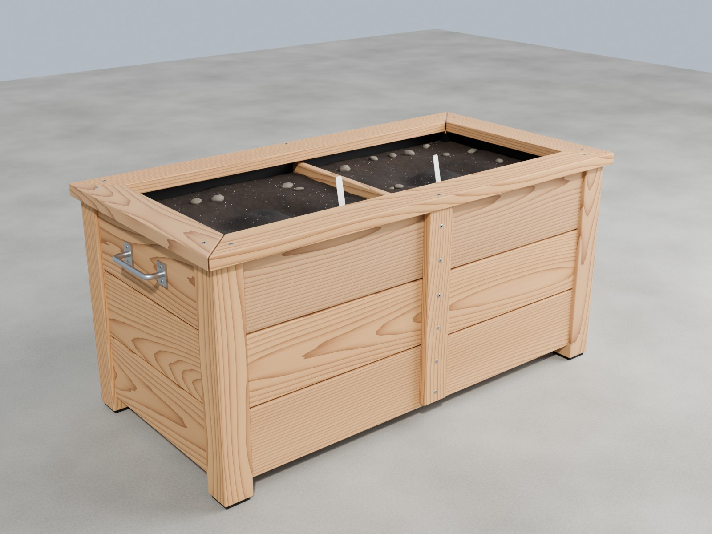
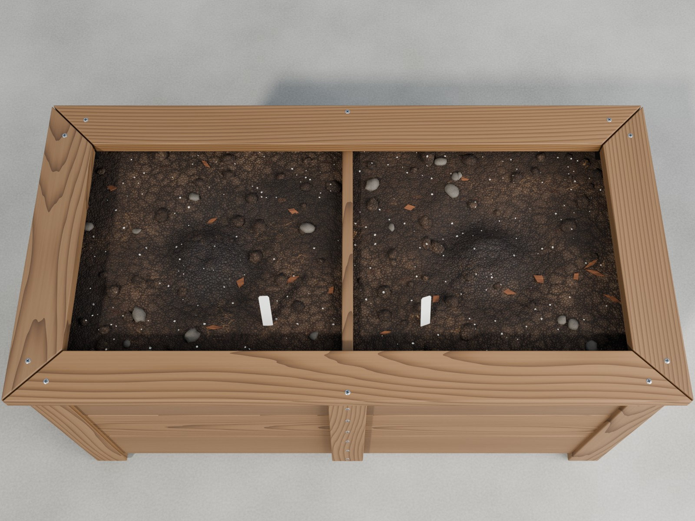
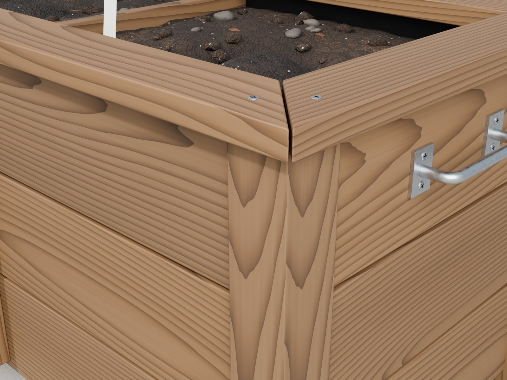

# Pflanzkasten für 2 Pflanzen – Blender-Modell

Detaillierter Holz-Pflanzkasten mit zwei getrennten Beeten, maßstabsgetreu in Metern.
Gedacht zum Einbauen in ein Gewächshaus-Modell in Blender; zusätzlich als GLB/FBX/OBJ
mit gebackenen Texturen für Game-Engines.



| Draufsicht | Detail: Gehrung, Schrauben, Griff |
| --- | --- |
|  |  |

## Eckdaten

| | |
| --- | --- |
| Außenmaß (L × B × H) | 1,03 × 0,53 × 0,49 m (mit Griffen 1,06 m lang) |
| Beete | 2 Stück, je ca. 46 × 43 cm, Erdtiefe ca. 34 cm (≈ 65 l Erde pro Pflanze) |
| Pflanzstellen | Empties `PlantSlot_1` und `PlantSlot_2` in der Mitte jedes Beets |
| Polygone | ca. 20 700 Dreiecke (Blender-Datei mit Bevels), Export ca. 19 800 Dreiecke |
| Ursprung | Am Boden, in der Mitte des Kastens (Empty `Planter_Box`) |

**Enthaltene Details**

- 4 Eckpfosten 6 × 6 cm auf schwarzen Gummifüßen, 4 cm Bodenfreiheit
- 3 Bretter pro Seite mit Nut und Feder und Schattenfuge, Kanten leicht gefast
- Abdeckleiste auf Gehrung mit Haarfuge, verschraubt (Kreuzschlitzschrauben)
- Außen eine Verstärkungsleiste in der Mitte, innen eine Trennwand für die zwei Beete
- Bodenlatten auf Auflageleisten mit Spalten zum Ablaufen des Wassers
- Schwarze Folie als Innenauskleidung
- Erde mit Pflanzloch und Gießrand, frisch gegossene (dunklere) Stelle um die Pflanze,
  Perlite-Körnchen und kleine Kieselsteine
- Verzinkte Griffe an beiden Stirnseiten, je ein Pflanzstecker pro Beet
- Prozedurale Materialien: Holz mit echten Jahresringen (jedes Brett anders), Erde, Folie,
  verzinkter Stahl, Gummi, Kunststoff

## Dateien

| Datei | Inhalt |
| --- | --- |
| `planter_box.blend` | Das Modell (Collection `Planter_Box`, als Asset markiert) |
| `planter_box.py` | Generator-Skript: baut den Kasten, alle Maße einstellbar |
| `export/planter_box.glb` | Ein Mesh, ein Material, Texturen eingebettet |
| `export/planter_box.fbx`, `export/planter_box.obj` | Gleiches Mesh, Texturen in `export/textures/` |
| `export/textures/` | 2048 × 2048: Basecolor, Roughness, Metallic, Normal (OpenGL), Ambient Occlusion |
| `bake_export.py` | Erzeugt die Exporte und Texturen neu |
| `render_preview.py` | Erzeugt die Vorschaubilder in `previews/` neu |

## In dein Gewächshaus einbauen

### Variante A: Anhängen (empfohlen)

1. Deine Gewächshaus-Datei öffnen.
2. **Datei → Anhängen** (File → Append) → `planter_box.blend` → `Collection` → `Planter_Box`.
3. Das Empty **`Planter_Box`** auswählen und mit `G` / `R` an seinen Platz bringen.
   Alle Teile hängen daran und bewegen sich mit.

Für mehrere gleiche Kästen im Append-Dialog **„Instance Collections“** aktivieren und die
Instanz dann mit `Alt+D` duplizieren. Das spart Speicher.

Alternativ: Den Ordner in den Einstellungen unter *File Paths → Asset Libraries* hinzufügen.
Dann liegt der Kasten im Asset Browser und lässt sich per Drag & Drop in die Szene ziehen.

### Variante B: Skript direkt in der Gewächshaus-Datei

1. Den 3D-Cursor an die Stelle setzen, an der der Kasten stehen soll (`Shift + Rechtsklick`).
2. Arbeitsbereich **Scripting** → **Öffnen** → `planter_box.py` → **Run Script** (▶).
3. Der Kasten entsteht in einer eigenen Collection am 3D-Cursor. Erneutes Ausführen ersetzt
   ihn; der Rest deiner Szene bleibt unangetastet.

So kannst du auch die Maße ändern (siehe unten).

### Variante C: GLB / FBX importieren

**Datei → Importieren → glTF 2.0** → `export/planter_box.glb`. Ein einziges Mesh mit einem
texturierten Material. Das ist die richtige Wahl für Game-Engines oder wenn deine
Blender-Version die `.blend` nicht öffnen kann.

### Pflanzen einsetzen

Die Pflanzstellen sind die Empties `PlantSlot_1` und `PlantSlot_2` (Pfeil nach oben, sitzt
genau im Pflanzloch):

1. `PlantSlot_1` auswählen → `Shift+S` → *Cursor to Selected*.
2. Deine Pflanze auswählen → `Shift+S` → *Selection to Cursor*.
3. Optional mitbewegen lassen: Pflanze auswählen, dann `Shift`-Klick auf `PlantSlot_1`,
   `Strg+P` → *Object (Keep Transform)*.

## Maße anpassen

Oben in `planter_box.py` stehen alle Parameter im Block `P` (Werte in Metern):

| Parameter | Standard | Bedeutung |
| --- | --- | --- |
| `length` / `width` | 1.00 / 0.50 | Außenmaß des Kastens ohne Abdeckleiste |
| `rows` | 3 | Anzahl Bretter übereinander (bestimmt die Höhe) |
| `plank_h` | 0.14 | Brettbreite |
| `clearance` | 0.04 | Bodenfreiheit |
| `soil_drop` | 0.055 | Wie tief die Erde unter der Oberkante liegt |
| `pebbles` | 14 | Kieselsteine pro Beet |
| `seed` | 7 | Zufallswert für Maserung, Erde und Steine |

Beispiel: `length = 1.4`, `rows = 4` ergibt einen langen, höheren Kasten; die zwei Beete und
Pflanzstellen passen sich automatisch an. Danach das Skript ausführen (Variante B). Wenn du
die Exporte für die neuen Maße brauchst, `bake_export.py` laufen lassen (siehe unten).

## Neu erzeugen (Kommandozeile)

Im Ordner `3d/planter-box`:

```bash
blender --background --python planter_box.py -- --save planter_box.blend
```

```bash
blender --background --python bake_export.py -- --out export --size 2048
```

```bash
blender --background --python render_preview.py -- --out previews
```

`--size 4096` liefert schärfere Texturen (dauert länger, Dateien werden etwa viermal so groß).

## Hinweise

- Die `.blend` wurde mit Blender 5.2 gespeichert. Das Skript ist für Blender 4.2 oder neuer
  geschrieben (getestet mit 5.2). Ältere Versionen öffnen die `.blend` eventuell nicht;
  dann Variante B oder C nehmen.
- Die Materialien in der `.blend` sind prozedural (keine Bilddateien nötig) und laufen in
  EEVEE und Cycles; die Vorschaubilder sind mit Cycles gerendert. In andere Programme
  kommen die Materialien nur über die gebackenen Texturen im Ordner `export/`.
- Teile in der `.blend`: `Planter_Wood` (Holz, mit Bevel-Modifier), `Planter_Liner`,
  `Planter_Soil`, `Planter_Pebbles`, `Planter_Hardware` (Schrauben, Griffe, Füße),
  `Planter_Labels`.
