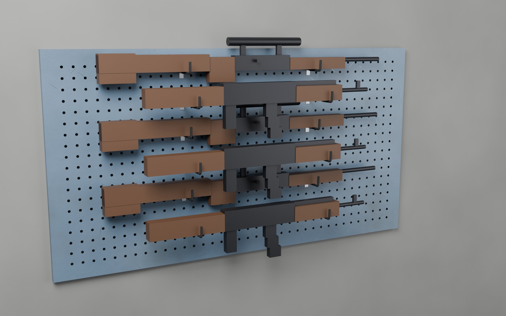

# Waffenwand (Lochwand) 150 × 80 cm für 6 Waffen

Dieselbe Lochwand wie die [Werkzeugwand](../werkzeugwand/), aber mit gummierten Gewehrhaken für
sechs Waffen. Jede Waffe liegt waagerecht auf zwei Haken. Pro Waffe gibt es ein Proxy-Empty,
an dem die Waffe eingesetzt wird. Alle anderen Löcher sind frei für weitere Haken.



Die Gewehre auf den Bildern sind grobe Platzhalter zum Prüfen der Abstände. Sie sind nicht Teil
der Exporte.

| | |
| --- | --- |
| Größe | 150 cm breit × 80 cm hoch × 2,5 cm Wandabstand |
| Lochung | rund Ø 10 mm, Raster 38 mm, 37 Spalten × 19 Reihen = 703 Löcher |
| Waffen | 6, waagerecht übereinander, Lauf nach rechts (+X) |
| Haken | 12 Gewehrhaken in Spalte 12 und 26 (53 cm Abstand, für Waffen ab etwa 60 cm Länge) |
| Polygone | **14 936 Dreiecke** gesamt: Platte 11 720, Gewehrhaken 148 bzw. 388 je Stück |
| Einheit | 1 Einheit = 1 Meter |

Für DayZ ist wie bei der Werkzeugwand weggelassen, was an der Wand nie zu sehen ist (Rückseite
des Blechs, Lochwände, Steckstifte). Details dazu stehen in der
[Werkzeugwand-Anleitung](../werkzeugwand/README.md#für-dayz-optimiert).

## Warum zwei Tiefen?

Sechs Gewehre auf 80 cm Höhe liegen nur 11,4 cm übereinander. Damit sich Magazine, Griffe und
Zielfernrohre nicht durchdringen, liegen die Waffen abwechselnd in zwei Ebenen:

| Haken | Waffe liegt (Mitte) | Ausladung des Hakens | Dreiecke |
| --- | --- | --- | --- |
| `gewehr_nah` | 4 cm vor der Platte | 9,7 cm | 148 |
| `gewehr_fern` | 14 cm vor der Platte, ein Buckel hält sie dort | 18 cm | 388 |

Waffen in derselben Ebene haben so 22,8 cm Abstand. Beide Haken haben einen verzinkten Ansatz an
der Steckplatte und eine schwarze Gummierung (Ø 9 mm), auf der die Waffe liegt.

## Waffen-Proxys

In Blender heißen die Empties `Proxy_Waffe_1` bis `Proxy_Waffe_6` (von oben nach unten). Sie sind
auch in `waffenwand.fbx` enthalten, die Zahlen stehen in `waffen_positionen.csv`.

| Waffe | Reihe | Tiefe | Blender (X, Y, Z) | FBX / OBJ (X, Y, Z) |
| --- | --- | --- | --- | --- |
| 1 | 1 | nah | 0, −0,067, 0,3205 | 0, 0,3205, 0,067 |
| 2 | 4 | fern | 0, −0,166, 0,2065 | 0, 0,2065, 0,166 |
| 3 | 7 | nah | 0, −0,067, 0,0925 | 0, 0,0925, 0,067 |
| 4 | 10 | fern | 0, −0,166, −0,0215 | 0, −0,0215, 0,166 |
| 5 | 13 | nah | 0, −0,067, −0,1355 | 0, −0,1355, 0,067 |
| 6 | 16 | fern | 0, −0,166, −0,2495 | 0, −0,2495, 0,166 |

Jeder Punkt liegt mittig zwischen den beiden Haken einer Waffe, in der Mitte der Mulde und oben
auf der Gummierung, also genau dort, wo die Unterseite der Waffe aufliegt. Wo der Ursprung eines
Waffenmodells sitzt, ist von Waffe zu Waffe verschieden. Den Proxy deshalb in Object Builder so
weit nach oben schieben, bis die Waffe auf den Haken liegt, und so drehen, dass der Lauf nach
rechts (+X) zeigt und die Waffe flach mit der Seite zur Wand liegt.

Welcher Haken zu welcher Waffe gehört, zeigt `vorschau/belegungsplan.jpg`.

## Dateien

| Datei | Inhalt |
| --- | --- |
| `waffenwand.blend` | Blender-Szene mit Platte, Haken, Waffen-Proxys, Vorlagen, Kollisionsbox und den Platzhalter-Gewehren (Collection `Platzhalter_Waffen`, ausgeblendet) |
| `waffenwand.fbx` | Platte + Gewehrhaken + Waffen-Proxys |
| `waffenwand.obj` / `.mtl` | Platte + Gewehrhaken |
| `einzelteile/haken_gewehr_nah.*`, `haken_gewehr_fern.*` | die beiden Gewehrhaken einzeln, mit Empty am Auflagepunkt |
| `einzelteile/lochwand_platte.*` | nur die Lochwand |
| `einzelteile/lochwand_kollision.*` | geschlossene Box (12 Dreiecke) für Geometry / View Geometry / Fire Geometry / Shadow LOD |
| `texturen/` | Texturen und `.rvmat` für Platte, Haken und Gummierung |
| `waffen_positionen.csv` | Position jedes Waffen-Proxys und die zugehörigen Haken |

Die Texturen sind dieselben wie bei der Werkzeugwand, dazu kommt `lochwand_gummi` (256 px = 25 cm)
für die Gummierung. Wie man sie für DayZ umwandelt und die `.rvmat`-Pfade anpasst, steht in der
[Werkzeugwand-Anleitung](../werkzeugwand/README.md#texturen). Die Gewehrhaken haben zwei
Materialien: `Lochwand_Haken` (verzinkt) und `Lochwand_Gummi`.

## Anpassen und neu erzeugen

Der Generator liegt bei der Werkzeugwand. Oben im Skript stehen:

- `WAFFEN`: je Waffe die Reihe des oberen Hakenlochs (1–18) und die Tiefe (`"nah"`/`"fern"`)
- `WAFFE_SPALTEN`: die beiden Spalten der Haken, z. B. `(14, 24)` für kurze Waffen

```bash
blender --background --python ../werkzeugwand/generate_werkzeugwand.py -- --variante waffenwand
```

Mit Vorschaubildern:

```bash
blender --background --python ../werkzeugwand/generate_werkzeugwand.py -- --variante waffenwand --render
```
