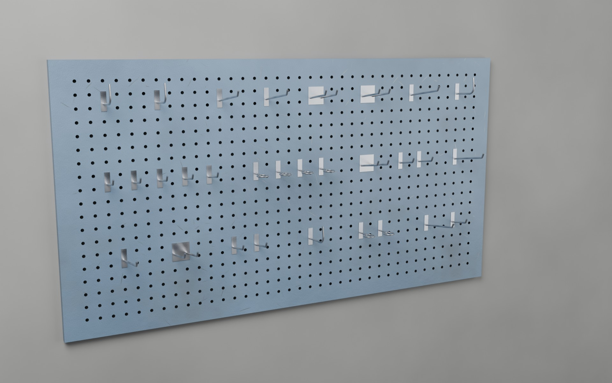

# Werkzeugwand (Lochwand) 150 × 80 cm

3D-Modell einer Werkzeug-Lochwand mit Haken, die nach vorne aus der Wand stehen. An jedem
Haken sitzt ein Empty als Markierung für einen Proxy (z. B. Werkzeug, das am Haken hängt).
Die runden Löcher sind echte Geometrie, also kann man überall weitere Haken einsetzen.
Texturen für Blender und DayZ (`_co`, `_nohq`, `_smdi`, `.rvmat`) liegen in `texturen/`.



| | |
| --- | --- |
| Größe | 150 cm breit × 80 cm hoch × 2,5 cm Wandabstand |
| Lochung | rund Ø 10 mm, Raster 38 mm, 37 Spalten × 19 Reihen = 703 Löcher |
| Blech | Vorderseite als Fläche, Rand rundum 2,5 cm nach hinten abgekantet |
| Haken | 30 Stück, 5 Typen (siehe unten) |
| Polygone | **16 488 Dreiecke** gesamt: Platte 11 720 (12 Kanten je Loch), Haken 104–296 je Stück |
| Einheit | 1 Einheit = 1 Meter |

### Für DayZ optimiert

Weggelassen ist nur, was man an der Wand hängend nie sieht:

- Rückseite des Blechs, die Innenwände der Löcher und die Innenseite des Rands. Die Platte ist
  also nach hinten offen und nur von vorne und von der Seite sichtbar.
- Die Steckstifte der Haken, die hinter der Steckplatte im Loch stecken.

Mit `RUECKSEITE = True` und `STIFTE = True` oben im Skript entsteht wieder das geschlossene Modell
(rund 49 000 Dreiecke). Das Skript gibt beim Erzeugen die Dreieckszahl aus und warnt ab 30 000
(`MAX_DREIECKE`). Jeder weitere Haken kostet 104–296 Dreiecke, es ist also noch Platz für viele.

## Dateien

| Datei | Inhalt |
| --- | --- |
| `werkzeugwand.blend` | Blender-Szene: Platte, Haken, Proxy-Empties, Vorlagen und Kollisionsbox, Materialien mit Texturen |
| `werkzeugwand.fbx` | Platte + alle Haken + Proxy-Empties |
| `werkzeugwand.obj` / `.mtl` | Platte + alle Haken (OBJ kennt keine Empties) |
| `einzelteile/lochwand_platte.*` | nur die Lochwand ohne Haken |
| `einzelteile/haken_<typ>.*` | jeder Hakentyp einzeln, Ursprung am Einsteckpunkt |
| `einzelteile/lochwand_kollision.*` | geschlossene Box (12 Dreiecke) für Geometry / View Geometry / Fire Geometry / Shadow LOD |
| `texturen/` | alle Texturen und DayZ-Materialien (siehe unten) |
| `proxy_positionen.csv` | Nummer, Typ, Loch und Koordinaten jedes Hakens und Proxys |
| `vorschau/belegungsplan.jpg` | Ansicht von vorne mit Spalten-, Reihen- und Hakennummern |
| `generate_werkzeugwand.py` | Skript, das alles oben erzeugt (Maße und Hakenbelegung stehen oben drin) |
| `texturen.py` | erzeugt die Texturen |
| `vorschau.py` | rendert die Vorschaubilder |

## Achsen und Ursprung

Der Ursprung liegt in der Mitte der Rückseite, also auf der Wandfläche, an der die Lochwand hängt.

| | Blender | FBX / OBJ |
| --- | --- | --- |
| rechts | +X | +X |
| oben | +Z | +Y |
| vorne (aus der Wand heraus) | −Y | +Z |
| Vorderseite der Platte | Y = −0,025 | Z = +0,025 |

FBX und OBJ sind Y-up mit Vorderseite nach +Z, so wie das P3D-Koordinatensystem. Steht die Wand
nach dem Import verkehrt herum, einfach um 180° um die Hochachse drehen.

## Hakentypen

Alle Haken haben eine Steckplatte, die das obere Loch und das Loch darunter abdeckt. Die
Steckstifte dahinter sind unsichtbar und deshalb standardmäßig weggelassen (`STIFTE = True` baut
sie mit: oben durchs Loch und hinter dem Blech hochgebogen, unten gerade eingesteckt). Der Ursprung jedes Hakens ist die Mitte des
oberen Lochs auf der Vorderseite der Platte.

| Typ | Beschreibung | Ausladung | Proxy-Empty sitzt … |
| --- | --- | --- | --- |
| `kurz` | Einzelhaken, Spitze hochgebogen | 8,5 cm | oben auf dem Arm, bei 70 % der Länge |
| `lang` | Einzelhaken, Spitze hochgebogen | 16 cm | oben auf dem Arm, bei 70 % der Länge |
| `doppel` | zwei Arme im Abstand 38 mm, belegt 2 Spalten | 11 cm | mittig zwischen den Armen |
| `bogen` | J-Haken für Kabel und Schläuche | 9,5 cm | unten in der Biegung |
| `ring` | Ringhalter, innen Ø 2,9 cm (Schraubendreher, Spraydosen) | 7,7 cm | Ringmitte |

## Proxys setzen

- In Blender hängt an jedem Haken ein Empty `Proxy_<Nr>_<Typ>` (Kind des Hakens). Wird der Haken
  verschoben, wandert der Proxy mit. Die Empties sind auch in `werkzeugwand.fbx` enthalten.
- `proxy_positionen.csv` enthält dieselben Punkte als Zahlen: `proxy_blender_*` für Blender,
  `proxy_objfbx_*` für die exportierten FBX-/OBJ-Dateien (und damit für Object Builder). Welcher
  Haken welche Nummer hat, zeigt `vorschau/belegungsplan.jpg`.
- Die Hakenmeshes heißen `Haken_<Nr>_<Typ>`, das Material der Platte `Lochwand_Platte` und das
  der Haken `Lochwand_Haken`.

## Texturen

Alle Texturen sind kachelbar und werden von `texturen.py` erzeugt. Die Platte ist taubenblau
lackiert mit leichten Kratzern und Schmutz, die Haken sind verzinkt.

| Datei | Verwendung |
| --- | --- |
| `<name>_co.png` | Farbe – Blender und DayZ |
| `<name>_nohq.png` | Normal Map für DayZ (DirectX-Format, Grün invertiert) |
| `<name>_smdi.png` | DayZ: Rot = 1, Grün = Glanzstärke, Blau = Glanzschärfe |
| `<name>_normal.png` | Normal Map für Blender (OpenGL-Format) |
| `<name>_rough.png`, `<name>_metal.png` | Rauheit und Metallic für Blender |
| `<name>.rvmat` | DayZ-Material (Super-Shader), verweist auf `_nohq.paa` und `_smdi.paa` |

`<name>` ist `lochwand_platte` (1024 px = 1 m) oder `lochwand_haken` (512 px = 25 cm). Die UVs
sind per Box-Projektion so skaliert: Platte 1 UV-Einheit = 1 m, Haken 1 UV-Einheit = 25 cm.

In Blender sind die Texturen schon an die Materialien angeschlossen (relative Pfade, den Ordner
`texturen/` also neben der `.blend` lassen). FBX und OBJ verweisen ebenfalls relativ darauf.

Für DayZ:

1. Die `_co`-, `_nohq`- und `_smdi`-PNGs mit ImageToPAA (DayZ Tools) in `.paa` umwandeln.
2. In beiden `.rvmat`-Dateien den Pfad `MeinMod\werkzeugwand\data` auf den eigenen Mod-Pfad
   ändern (oder `DAYZ_PFAD` in `texturen.py` setzen und neu erzeugen).
3. In Object Builder den Flächen der Platte `lochwand_platte_co.paa` als Textur und
   `lochwand_platte.rvmat` als Material zuweisen, den Haken entsprechend die `lochwand_haken`-Dateien.

Wirkt die Beleuchtung der Oberfläche im Spiel verkehrt herum (Kratzer stehen hervor statt
vertieft), ist das Normal-Format vertauscht: dann `_normal.png` statt `_nohq.png` umwandeln.

## Weitere Haken einsetzen

Lochpositionen (Spalte 1–37 von links, Reihe 1–19 von oben, Ursprung jeweils in der Lochmitte):

```
X        = (Spalte − 19) × 0,038
Höhe     = (10 − Reihe) × 0,038      (Blender Z, FBX/OBJ Y)
Vorne    = 0,025                     (Blender −Y, FBX/OBJ +Z)
```

Ein Haken auf Spalte/Reihe hängt im Loch (Spalte, Reihe) und steckt unten in (Spalte, Reihe + 1).

**Im Skript (empfohlen):** In `generate_werkzeugwand.py` die Liste `HAKEN` erweitern, z. B.
`("lang", 10, 5)`, und neu erzeugen. Das Skript prüft, dass kein Loch doppelt belegt ist und sich
keine Haken überschneiden, und schreibt CSV, Exporte und `.blend` neu.

**In Blender:** Einen Haken samt Proxy-Empty auswählen, mit `Alt+D` verknüpft duplizieren und um
ganze Löcher verschieben, z. B. `X` und `0.038*4` eintippen (4 Löcher nach rechts) oder `Z` und
`-0.038*6` (6 Reihen tiefer). Die Vorlagen aller Typen liegen in der ausgeblendeten Collection
`Haken_Vorlagen` am Ursprung. Das Viewport-Gitter ist auf 38 mm gestellt und Einrasten auf
„Gitter“, sodass ein Haken mit gedrückter `Strg`-Taste in der Vorderansicht auf Lochpositionen
springt.

**In Object Builder:** Die Haken aus `einzelteile/` als eigene P3D-Modelle anlegen und auf der Wand
als Proxys an den Lochpositionen oben platzieren.

## Neu erzeugen

Mit Blender (4.2 oder neuer):

```bash
blender --background --python generate_werkzeugwand.py
```

Mit Vorschaubildern (Cycles, dauert ein paar Minuten):

```bash
blender --background --python generate_werkzeugwand.py -- --render
```

Ohne installiertes Blender geht es auch mit dem `bpy`-Modul (`pip install bpy`, passend zur
Python-Version):

```bash
python generate_werkzeugwand.py --render
```

Größe, Raster, Lochdurchmesser, Blechstärke, Drahtstärke und die Polygonzahl stehen als
Konstanten oben im Skript. `LOCH_SEGMENTE` ist die Kantenzahl je Loch: 16 = runder
(+2 800 Dreiecke), 8 = sparsamer (−2 800 Dreiecke). `SEITEN` steuert die Kanten des
Hakendrahts. Bei anderer Größe `SPALTEN` und `REIHEN` ungerade lassen, damit die
Lochpositionen ganze Vielfache von 38 mm bleiben.
